<div align="center">

# Sotto

**The free, open-source alternative to Parakeet AI, Cluely, Final Round AI, LockedIn AI
and similar AI interview and meeting assistants.**

Live transcription of both sides of a call, instant AI answers and suggestions, meeting
notes, and a mock interviewer that talks to you. Free, private, and you bring your own
AI model.

[](https://github.com/taarruunnnn/sotto/releases/latest)
[](LICENSE)


[](https://tauri.app)

[**Download**](https://github.com/taarruunnnn/sotto/releases/latest) ·
[How it works](#how-it-works) ·
[Cost](#cost-under-1-an-hour-no-subscription) ·
[Lightweight](#tiny-and-lightweight) ·
[API keys](#which-api-keys-work) ·
[For developers](#for-developers) ·
[Contribute](#contributing)

<br><br>

<a href="#see-it-in-action">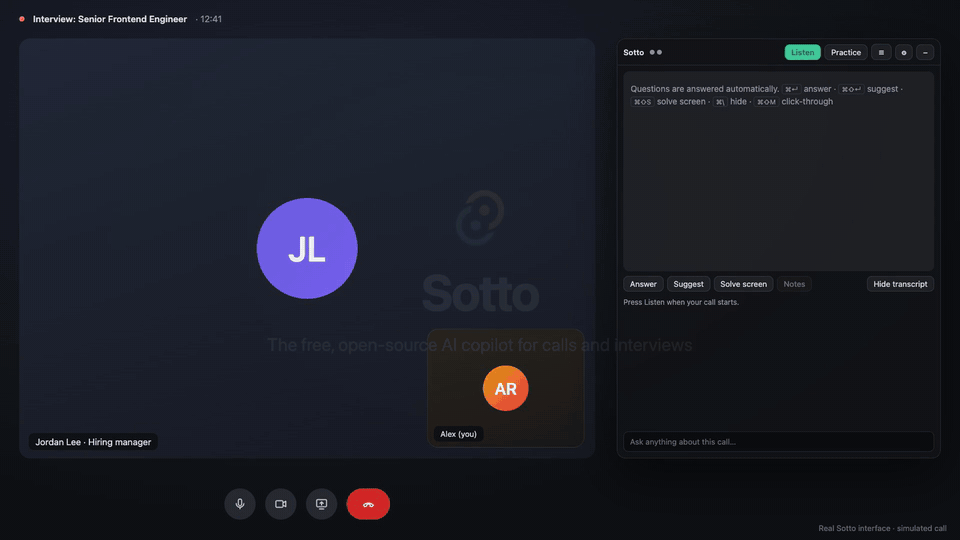</a>

</div>

---

## See it in action

https://github.com/user-attachments/assets/59752938-bdb2-4ed7-b082-ac9c57081c27

<sub>No sound. Can't see the player? [Download the trailer](docs/media/trailer.mp4).</sub>

<table>
  <tr>
    <td width="50%">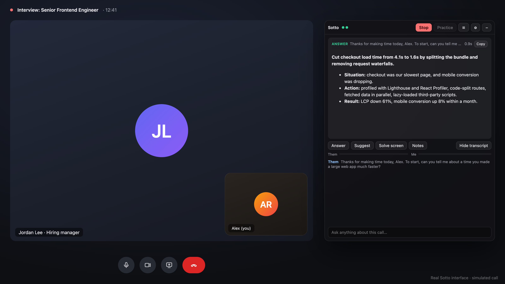</td>
    <td width="50%">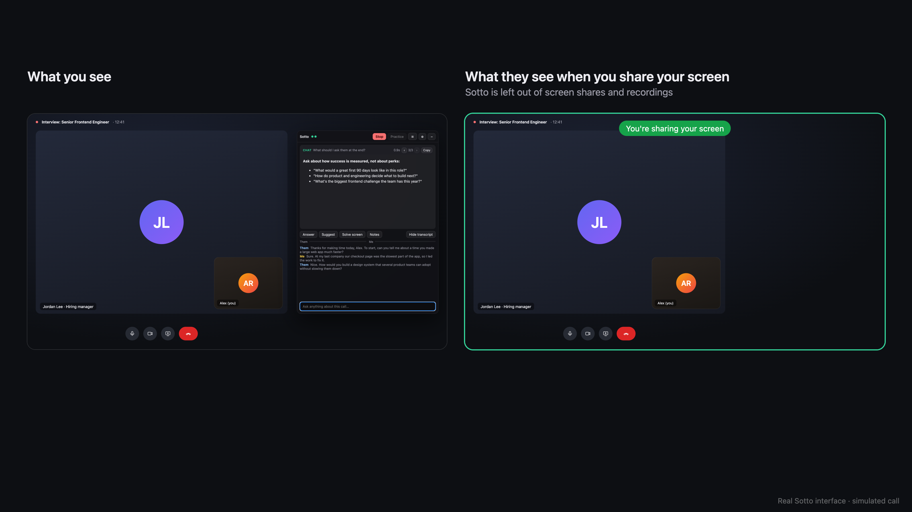</td>
  </tr>
  <tr>
    <td align="center">Answers appear while the call goes on</td>
    <td align="center">Left out of screen shares and recordings</td>
  </tr>
</table>

<table>
  <tr>
    <td width="25%">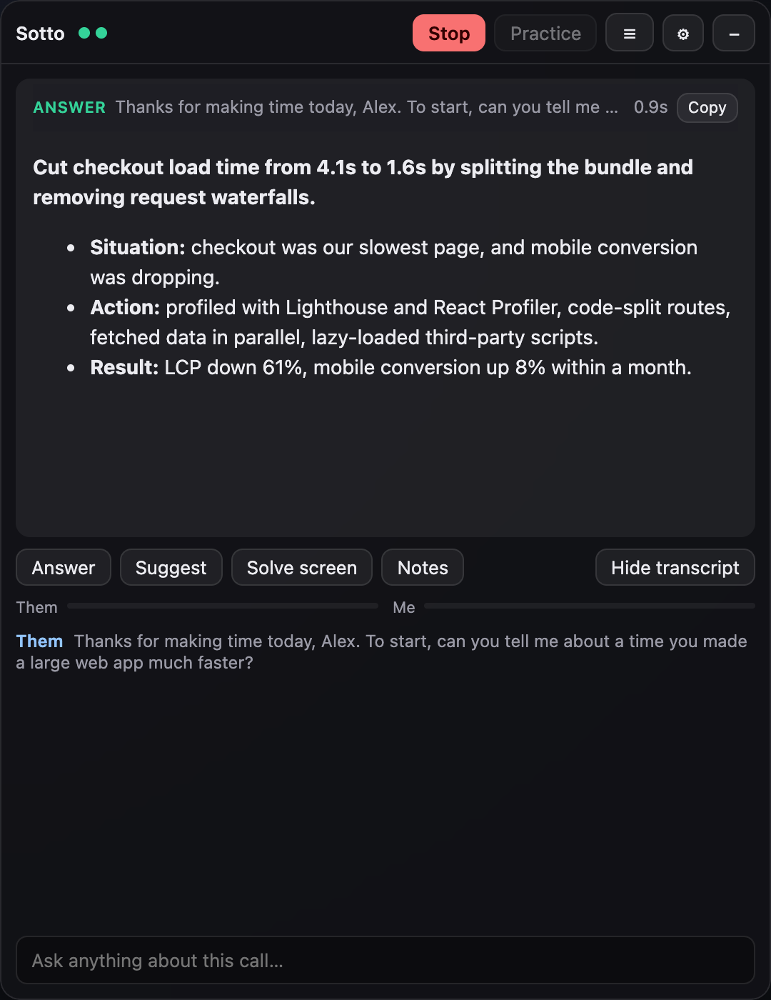</td>
    <td width="25%">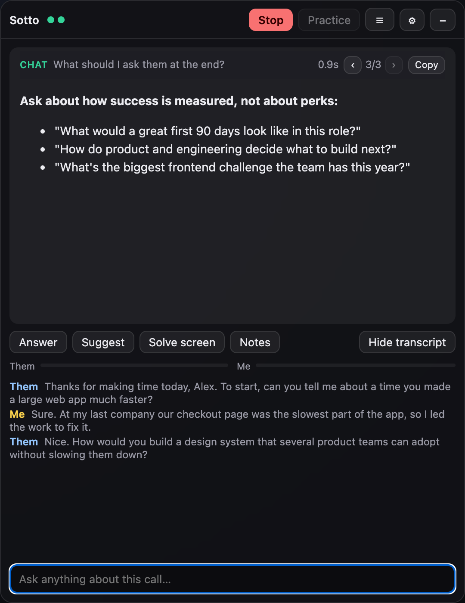</td>
    <td width="25%">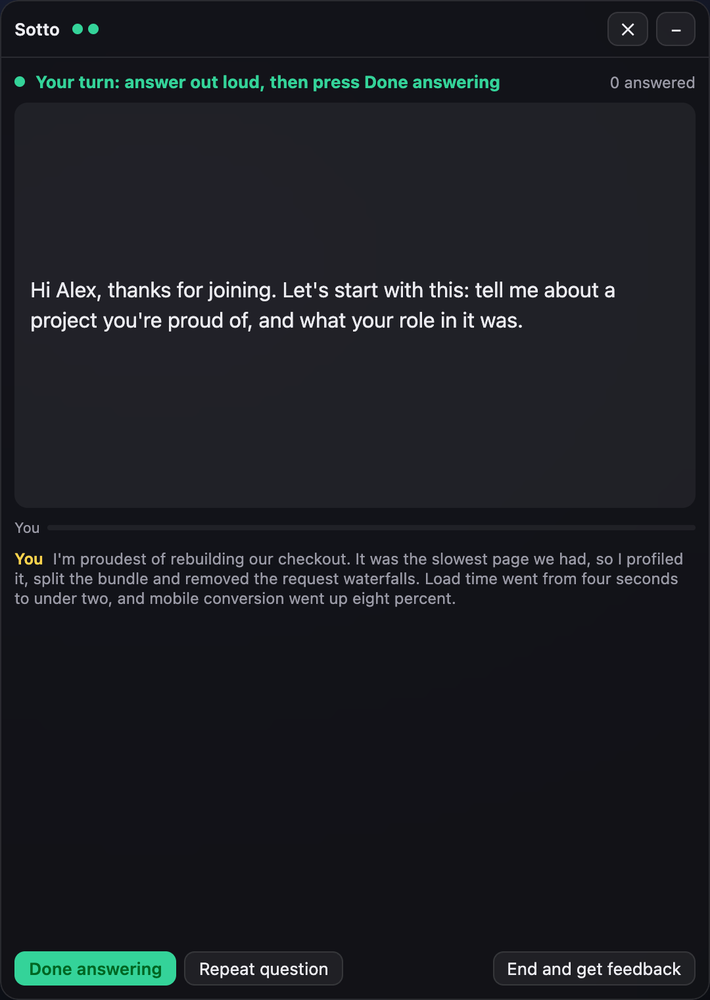</td>
    <td width="25%">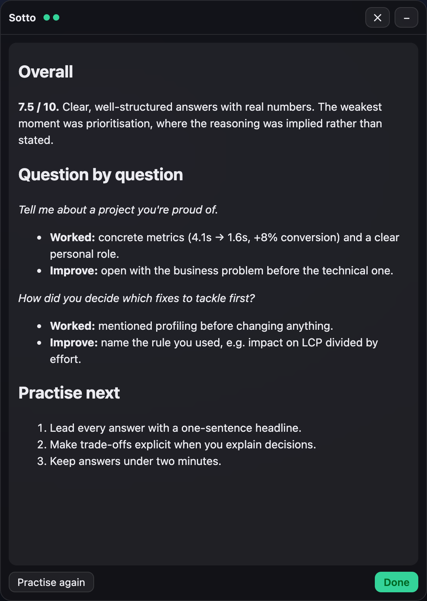</td>
  </tr>
  <tr>
    <td align="center">Short, speakable answers</td>
    <td align="center">Ask anything mid-call</td>
    <td align="center">Practise with an AI interviewer</td>
    <td align="center">Get scored feedback</td>
  </tr>
  <tr>
    <td>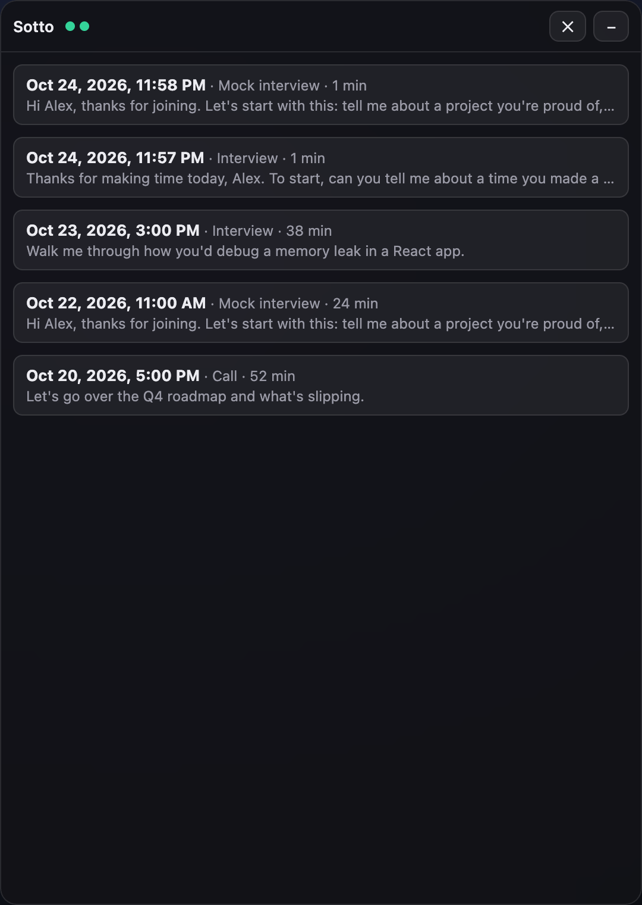</td>
    <td>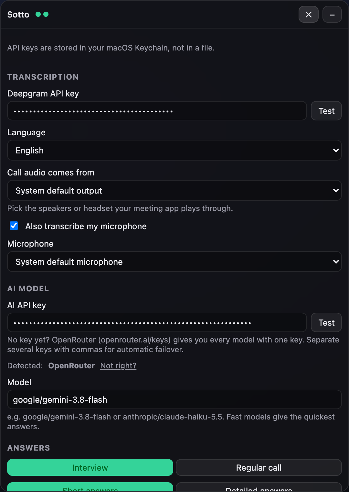</td>
    <td colspan="2" valign="top">
      <br>
      <b>Past calls</b> keep transcripts and notes on your computer.<br><br>
      <b>One key box</b> works out whether your key is OpenRouter, OpenAI, Anthropic or Google.<br><br>
      <sub>The trailer and screenshots show the real Sotto interface on a simulated call: the
      transcript and AI replies are scripted, so no real keys or calls are involved. Make them
      again with <code>node demo/record.mjs</code>.</sub>
    </td>
  </tr>
</table>

---

## Why Sotto?

Tools like Parakeet AI, Cluely, Final Round AI and LockedIn AI are closed-source and
paid: you buy a plan or credits, your conversations go through their service, and you use
whatever AI model they choose.

Sotto is a **free, open-source alternative to all of them**. It runs on your computer, talks directly to
the AI provider you pick with your own API key, and keeps transcripts on your machine.
The whole thing is MIT-licensed, so you can read every line, change it and ship your own
version.

| | **Sotto** | Parakeet AI and similar closed-source tools |
|---|---|---|
| Price | Free app; about **$0.85 an hour** in provider usage ([details](#cost-under-1-an-hour-no-subscription)) | Paid plans or credits |
| Source code | Open (MIT) | Closed |
| AI model | Your choice: Gemini, Claude, GPT or hundreds via OpenRouter | Chosen by the vendor |
| Your conversations | Stay on your computer; sent only to the providers you choose | Go through the vendor's service |
| API keys | Stored in your OS keychain | n/a |
| Interview practice | Built-in mock interviewer with spoken questions and scored feedback | Varies |
| Extend it | Fork it, add features, send a pull request | Request a feature and wait |

## Cost: under $1 an hour, no subscription

Sotto is free. You only pay the transcription and AI providers for what you actually use,
at their own prices, with no markup.

| | **Sotto** | **Parakeet AI** |
|---|---|---|
| One hour of live calls | **about $0.85** | $7.77–$24.83 (1 credit, depending on pack size) |
| One hour of mock interview | **about $0.40** | 1 credit |
| 10 hours of calls a month | **about $8.50** | ~$100 (Unlimited monthly) or $78–$248 in credits |
| Subscription | None | Weekly, monthly or yearly plans |
| Free usage | $200 of Deepgram credit for new accounts covers **200+ hours** of transcription | 10-minute free session, one free mock |

**Sotto is roughly 9 to 30 times cheaper per hour than Parakeet AI's credits**, and if you
use it for less than about 120 hours a month it costs less than an unlimited plan.

<details>
<summary>How these numbers were worked out</summary>

**Sotto, one hour of live calls with `google/gemini-3.8-flash` on OpenRouter:**
- Transcription: two Deepgram streams (your mic and the other side) × 60 min × $0.0048/min
  = **$0.58**
- AI answers: about 40 answers an hour, each about 5,000 input tokens (recent transcript,
  resume, instructions) and 500 output tokens including reasoning.
  200k input × $0.825/M + 20k output × $4.125/M = **$0.25**
- Total: **about $0.83 an hour**. With `anthropic/claude-haiku-5.5` it's about $0.61, and
  with `openai/gpt-5-mini` about $0.67.

**Sotto, one hour of mock interview:** one Deepgram stream (your mic only, $0.29) plus
about 25 interviewer turns and the feedback report (about $0.12): **about $0.40 an hour**.

**Parakeet AI**, from its pricing page, which shows prices in Indian rupees. Converted at
₹95 = $1:
- Unlimited: ₹4,980/week (~$52), ₹9,470/month (~$100) or ₹37,900/year (~$399)
- Credits: 1 credit = 1 hour of calls (0.5 credit = 30 minutes). Packs cost from ₹2,360
  for 1 credit (~$24.83 an hour) down to ₹738 per credit in the 15-credit pack (~$7.77 an
  hour).

Your actual cost depends on how long your calls are, how often answers are generated, and
the size of your resume and documents. Deepgram's rate is its current promotional
pay-as-you-go price ($0.0077/min normally, which makes a live-call hour about $1.17).
Prices checked in October 2026 and may change; check each provider's pricing page.
</details>

## What we suggest using it for

- **Interview practice.** The mock interviewer asks role-specific questions out loud,
  listens to your spoken answers, follows up when you're vague, and scores each answer
  with concrete tips. This is the best way to use Sotto for interviews.
- **Meetings and sales or support calls.** Pull facts from your own documents while you
  talk, get suggested follow-up questions, and finish with notes, decisions and action
  items you can paste anywhere.
- **Accessibility.** Live captions for both sides of a call help if you're hard of
  hearing, in a noisy place, or following a fast speaker.
- **Calls in a second language.** Read along with the transcript and ask the chat what a
  phrase meant or how to reply naturally.
- **Lectures, webinars and podcasts.** Capture what was said and turn it into notes.
- **Reviewing past calls.** Every call's transcript and notes are saved locally, so you
  can see what you were asked and how you could answer better next time.

## Responsible use

Sotto is a productivity, accessibility and practice tool. **We don't support or promote
using it to cheat**, for example in exams, graded assessments, certification tests, or
interviews where outside help isn't allowed.

- **Follow the rules of the room.** If an interview, test or meeting doesn't allow AI
  assistance, don't use it there. Practise beforehand with the mock interviewer instead.
- **Get consent before transcribing other people.** Recording and transcription laws vary
  by country and state, and many require everyone on the call to agree. Tell people you're
  using a transcription tool.
- **The overlay hides itself from screen shares for privacy**, so your private notes and
  documents aren't broadcast to everyone when you present. It isn't designed to evade
  proctoring or monitoring software, and we won't accept contributions that add that.
- **Check what the AI says.** Answers can be wrong. You're responsible for what you say.

## Features

- **Live transcription of both sides.** Your microphone ("Me") and the computer's audio
  ("Them") are captured separately and transcribed in real time with Deepgram `nova-3`.
  Choose devices and language (or multilingual auto-detect) in Settings.
- **Auto Answer.** When the other person asks a question, an answer starts streaming as
  soon as the question ends, often before they've paused. If they keep talking, it
  restarts with the full question.
- **Answers you can glance at.** One bold line you can say right away, then a few short
  bullet points. No walls of text. STAR format for behavioural questions; approach, code
  and complexity for coding questions.
- **Suggest.** Something natural to say next, plus key points and likely follow-ups.
- **Solve screen.** Send a screenshot to a vision model to explain a diagram, an error or
  a document on your screen. Add several screenshots for multi-page content.
- **Chat.** Ask anything about the call so far.
- **Notes.** Summary, discussion points, decisions, action items and next steps.
- **Mock interview.** Spoken questions for the role you enter (behavioural, technical or
  mixed), follow-ups, and question-by-question feedback with a score.
- **Your context.** Add your resume and reference documents (PDF, DOCX, TXT, Markdown,
  CSV, JSON) plus up to 20,000 characters of instructions.
- **Call history.** The last 40 calls are saved on your computer, with transcripts,
  answers and notes. Copy any of them as Markdown.
- **Private by design.** API keys live in the macOS Keychain or Windows Credential
  Manager. The overlay stays out of screen shares and recordings, has no Dock or taskbar
  icon, and floats above full-screen apps. All of this can be turned off.
- **Keyboard first.** Global shortcuts work without switching windows (see below).
- **Key failover.** Add several API keys separated by commas; if one hits a limit, the
  next is used.

## Tiny and lightweight

Sotto is a few megabytes, on both macOS and Windows:

| | macOS | Windows |
|---|---|---|
| Download | **3.3 MB** (Apple Silicon `.dmg`), 3.5 MB (Intel) | **2.6 MB** (`.exe` installer), 3.5 MB (`.msi`) |
| Installed | about **6 MB** | one small native executable, plus Microsoft's WebView2, which Windows 10 and 11 already include |

*Measured on the v0.1.2 release.* For comparison, desktop apps built on Electron bundle a
whole copy of the Chromium browser and are usually well over 100 MB.

How it stays this small:

- **No bundled browser.** Sotto is built with [Tauri](https://tauri.app), which uses the
  web view the operating system already has (WebKit on macOS, WebView2 on Windows)
  instead of shipping its own.
- **A native Rust core.** Audio capture, transcription streaming, networking and keychain
  access are compiled Rust, built with link-time optimisation and stripped of debug data.
- **No bundled AI or speech models.** Transcription runs on Deepgram, answers come from
  the provider you choose, and the mock interviewer uses your system's built-in voices.
- **Load on demand.** The AI provider libraries, the PDF and Word parsers, the Markdown
  renderer and the settings, history and mock interview screens load the first time
  they're used, so startup only loads the overlay.
- **Light at runtime.** Audio level meters update the screen directly instead of
  re-rendering the app, streamed answers are drawn at most once per frame, and all AI
  requests share one kept-alive connection.

## How it works

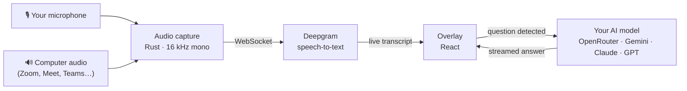

1. **Capture.** Sotto records your mic and, separately, whatever your computer is playing
   (macOS 14.6+ system audio tap, Windows WASAPI loopback). Both are converted to 16 kHz
   mono audio.
2. **Transcribe.** Each stream goes to Deepgram over its own WebSocket, so the transcript
   knows who said what and updates as people speak.
3. **Detect.** When the other side asks a question, Sotto notices immediately (no waiting
   for a long pause) and starts an answer. You can also trigger one any time with a
   shortcut.
4. **Answer.** The question, recent conversation, your resume and documents go to your
   chosen AI model, and the answer streams into the overlay word by word.
5. **Practise.** In mock interview mode the AI plays the interviewer: its questions are
   spoken with your system's text-to-speech voices, your spoken answers are transcribed,
   and you get feedback at the end.

## Which API keys work

Sotto needs two keys: one for transcription and one for the AI model. Both stay in your
OS keychain and are sent only to that provider.

**Transcription (required):** a [Deepgram](https://console.deepgram.com) API key. New
accounts get free credit.

**AI model (pick one):** paste the key and Sotto detects which service it belongs to.

| Provider | Key looks like | Suggested model | Notes |
|---|---|---|---|
| **[OpenRouter](https://openrouter.ai/keys)** (recommended) | `sk-or-…` | `google/gemini-3.8-flash` | One key for Gemini, Claude, GPT and hundreds of other models |
| [Google AI Studio](https://aistudio.google.com) | `AIza…` | `gemini-3.8-flash` | |
| [Anthropic](https://console.anthropic.com) | `sk-ant-…` | `claude-haiku-5-5` | |
| [OpenAI](https://platform.openai.com) | `sk-…` | `gpt-5-mini` | |
| [Vercel AI Gateway](https://vercel.com/ai-gateway) | (chosen manually) | `anthropic/claude-haiku-5.5` | |

**Pick a fast model.** In a live conversation, how quickly the answer starts matters more
than anything else. "Flash", "Haiku" and "mini" models start answering in about a second.
The model field accepts any model id, so new models work without an update.

**Cost:** you pay the providers directly for what you use: about $0.85 for an hour of
live calls. See [Cost](#cost-under-1-an-hour-no-subscription).

## Install

Download the latest installer from the
[Releases page](https://github.com/taarruunnnn/sotto/releases/latest).

### macOS (14.6 or later)

1. Download the `.dmg` for your Mac: `aarch64` for Apple Silicon (M1 and later), `x64`
   for Intel. To check, open  → About This Mac and look at "Chip".
2. Open the `.dmg` and drag **Sotto** into **Applications**.
3. Open Sotto from Applications. The builds aren't notarized by Apple yet, so the first
   launch is blocked:
   - Go to **System Settings → Privacy & Security**, scroll down and click
     **Open Anyway** next to the message about Sotto, then confirm.
   - If macOS says the app **"is damaged and can't be opened"**, run this in Terminal,
     then open it again:
     ```sh
     xattr -dr com.apple.quarantine /Applications/Sotto.app
     ```
4. Sotto has no Dock icon. Look for it in the **menu bar** (top right).

### Windows (10 version 2004 or later, or 11)

1. Download `Sotto_x.y.z_x64-setup.exe` (or the `.msi` if you prefer).
2. Run it. The installer isn't code-signed yet, so SmartScreen may show
   **"Windows protected your PC"**: click **More info → Run anyway**.
3. Sotto has no taskbar button. Look for it in the **system tray** (bottom right; it may
   be under the **^** overflow arrow).

Linux isn't supported yet. [Help wanted!](#contributing)

### First launch

A short setup walks you through:

1. Your **Deepgram** key, with a **Test** button.
2. Your **AI key**. Paste it and Sotto detects the provider. Then **Test** it.
3. An **audio check** with level meters for your mic and computer audio.

Then press **Listen** when a call starts, or **Practice** for a mock interview. You can
rerun the setup from Settings.

### Permissions

- **macOS:** allow **Microphone**, **System Audio Recording** and **Screen Recording**
  when asked. The audio check links straight to the right System Settings panes.
- **Windows:** no extra permissions.

### Troubleshooting

- **The "Them" meter doesn't move.** Sotto records the Mac's or PC's current output
  device. If the call plays through headphones plugged into a monitor, or another device,
  choose that device under Settings → Computer audio, or make it the system output.
- **Overlay visible in a Zoom screen share.** In Zoom, open Settings → Share Screen →
  Advanced and turn on **Advanced capture with window filtering**.
- **Icon still in the macOS Dock.** Turn off **Show suggested and recent apps** in
  System Settings → Desktop & Dock, then restart Sotto.
- **Answers are slow.** Use a fast model (see [above](#which-api-keys-work)). Each
  answer shows how long it took to start.

## Keyboard shortcuts

| macOS | Windows | Action |
|---|---|---|
| `⌘↵` | `Ctrl+Enter` | Answer the last question (or "Done answering" in a mock interview) |
| `⌘⇧↵` | `Ctrl+Shift+Enter` | Suggest something to say |
| `⌘⇧S` | `Ctrl+Shift+S` | Screenshot and explain |
| `⌘⇧A` | `Ctrl+Shift+A` | Add a screenshot (sent with the next one) |
| `⌘⇧[` / `⌘⇧]` | `Ctrl+Shift+[` / `Ctrl+Shift+]` | Previous / next answer |
| `⌘\` | `Ctrl+\` | Hide / show the overlay |
| `⌘⇧M` | `Ctrl+Shift+M` | Click-through mode (the mouse passes through the overlay) |
| `⌘ + arrows` | `Ctrl + arrows` | Move the overlay |

With the overlay focused, `Esc` stops the answer that's streaming.

## For developers

Sotto is a [Tauri 2](https://tauri.app) desktop app: a **Rust** backend for everything
that touches the operating system, and a **React + TypeScript** frontend for the UI and
AI logic.

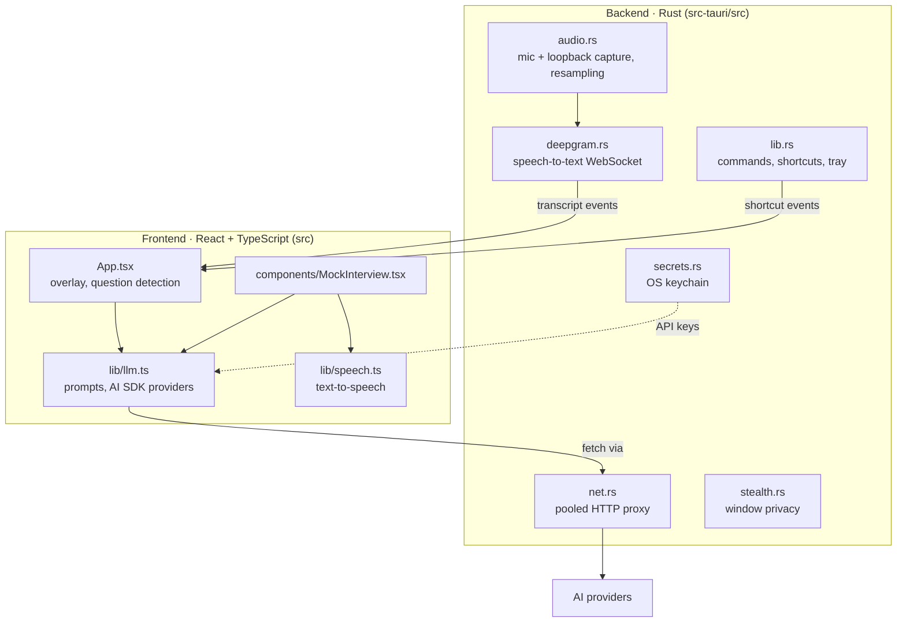

### Backend (Rust)

| File | What it does |
|---|---|
| `audio.rs` | Captures the mic and system audio with [cpal](https://github.com/RustAudio/cpal) (Core Audio process tap on macOS, WASAPI loopback on Windows), downmixes to mono, resamples to 16 kHz and reports levels for the meters |
| `deepgram.rs` | One WebSocket per audio source to Deepgram's live API; emits `transcript` and `transcriber-status` events to the UI |
| `net.rs` | A pooled, kept-alive HTTP client that AI requests stream through, avoiding browser CORS limits and repeated TLS handshakes |
| `secrets.rs` | Reads and writes API keys in the macOS Keychain / Windows Credential Manager via [keyring](https://crates.io/crates/keyring) |
| `stealth.rs` | Screen-capture exclusion, no Dock/taskbar icon, always on top |
| `lib.rs` | Tauri commands (start/stop session, screenshot, audio check), global shortcuts and the tray menu |

### Frontend (React + TypeScript)

| File | What it does |
|---|---|
| `App.tsx` | The overlay: live transcript, question detection, streaming answers, screenshots, sessions |
| `Settings.tsx`, `components/` | Settings, first-run setup, AI key detection, call history, mock interview, audio meters |
| `lib/llm.ts` | All prompts, and the [AI SDK](https://ai-sdk.dev) providers (OpenRouter, Anthropic, Google, OpenAI, AI Gateway) |
| `lib/net.ts` | `fetch` over `net.rs`, with multi-key failover |
| `lib/transcript.ts` | Transcript formatting and the instant question detector |
| `lib/speech.ts` | Text-to-speech for the mock interviewer, spoken sentence by sentence as text streams in |
| `lib/settings.ts`, `lib/sessions.ts` | Settings (keys go to the keychain) and saved calls |
| `lib/documents.ts` | Text extraction from PDF and DOCX uploads |

### Voice

- **In (speech-to-text):** Deepgram `nova-3` over WebSocket with interim results, so text
  appears while people are still speaking. Endpointing and utterance-end events mark when
  someone has finished.
- **Out (text-to-speech):** the Web Speech API with the operating system's voices, used by
  the mock interviewer. No extra key needed.

### AI

- Built on the [Vercel AI SDK](https://ai-sdk.dev), so adding a provider is a few lines in
  `lib/llm.ts`.
- Live answers ask reasoning models to think less, so they start in about a second.
  Screenshots and notes use the model's full reasoning.
- The resume, documents and instructions go in one cacheable system message, so repeated
  answers are faster and cheaper.

### Run it locally

Prerequisites: [Rust](https://rustup.rs), [Node 22+](https://nodejs.org), and the
[Tauri prerequisites](https://tauri.app/start/prerequisites/) for your OS (Xcode Command
Line Tools on macOS; Visual Studio C++ Build Tools and WebView2 on Windows).

```sh
git clone https://github.com/taarruunnnn/sotto.git
cd sotto
npm install
npm run tauri dev     # run with hot reload
npm run tauri build   # build an installer for this machine
```

- In `tauri dev` on macOS, audio and screen permissions are granted to your terminal app.
- Checks: `npx tsc --noEmit` for the frontend, `cargo test` in `src-tauri/` for the backend.
- Installers are written to `src-tauri/target/release/bundle/`. Each OS can only build its
  own installer.

### Screenshots and trailer

`demo/` runs the real interface in Chrome on a scripted call, with the Tauri backend
mocked (`demo/mock.ts`) and canned AI replies (`demo/script.ts`), so no keys are needed.
`node demo/record.mjs` writes the screenshots, `trailer.mp4` and `hero.gif` to `demo/out/`
(needs Google Chrome and ffmpeg). Copy the ones you want into `docs/media/`.

### Releasing

`.github/workflows/release.yml` builds macOS (Apple Silicon and Intel) and Windows
installers on GitHub Actions and attaches them to a draft release. Bump `version` in
`src-tauri/tauri.conf.json`, `package.json` and `src-tauri/Cargo.toml`, then push a tag:

```sh
git tag v0.1.3
git push origin v0.1.3
```

Review the draft on the Releases page and publish it.

## Contributing

**Sotto is open to contributions, and suggestions are just as welcome as code.**

- 💡 **Have an idea?** [Suggest a feature](https://github.com/taarruunnnn/sotto/issues/new?template=feature_request.md)
- 🐞 **Found a bug?** [Report it](https://github.com/taarruunnnn/sotto/issues/new?template=bug_report.md)
- 🛠️ **Want to code?** Read [CONTRIBUTING.md](CONTRIBUTING.md), then pick something below.
- ⭐ **Like it?** Star the repo and share it. It really helps other people find Sotto.

Good places to start:

- **Linux support** (audio loopback with PipeWire/PulseAudio)
- **Local, offline transcription** with Whisper or NVIDIA Parakeet, so no Deepgram key is needed
- **More practice modes:** case interviews, sales role-play, presentations, language practice
- **Higher-quality voices** for the mock interviewer
- **Signed and notarized builds**, and automatic updates
- **Translations** of the interface
- **Tests** for question detection, prompts and audio handling

## Roadmap

- [x] Live two-sided transcription, auto answers, notes, call history
- [x] Mock interview with spoken questions and feedback
- [x] OS keychain storage, OpenRouter and key auto-detection
- [ ] Local transcription (Whisper / NVIDIA Parakeet) for offline use
- [ ] Linux support
- [ ] Signed builds and auto-update
- [ ] More practice scenarios

## FAQ

**Is Sotto free?**
Yes. The app is free and open source under the MIT license. You pay Deepgram and your AI
provider directly for what you use, which is about $0.85 for an hour of live calls. New
Deepgram accounts get $200 of free credit. See [Cost](#cost-under-1-an-hour-no-subscription).

**Does it work with Zoom, Google Meet, Microsoft Teams and Slack?**
Yes. Sotto listens to your computer's audio, so it works with any call app, in the browser
or as a desktop app.

**Where does my data go?**
Audio goes to Deepgram for transcription, and text goes to the AI provider you chose.
Transcripts, notes and settings are stored only on your computer, and API keys are in your
OS keychain. There's no Sotto server.

**Can I use it offline?**
Not yet. Local transcription is on the [roadmap](#roadmap).

**Is Sotto a cheating tool?**
No. It's built for practice, meetings, accessibility and note-taking. See
[Responsible use](#responsible-use).

**Is Sotto an alternative to Parakeet AI?**
Yes. Sotto is a free, open-source alternative to Parakeet AI, Cluely, Final Round AI,
LockedIn AI and similar tools.

**How is it different from Parakeet AI, Cluely or Final Round AI?**
Sotto is open source, free, runs with your own keys and model, keeps your data on your
machine, and focuses on practice and productivity. See [Why Sotto?](#why-sotto)

## License

[MIT](LICENSE). Sotto isn't affiliated with or endorsed by any of the companies or
products mentioned in this README. All trademarks belong to their owners.
